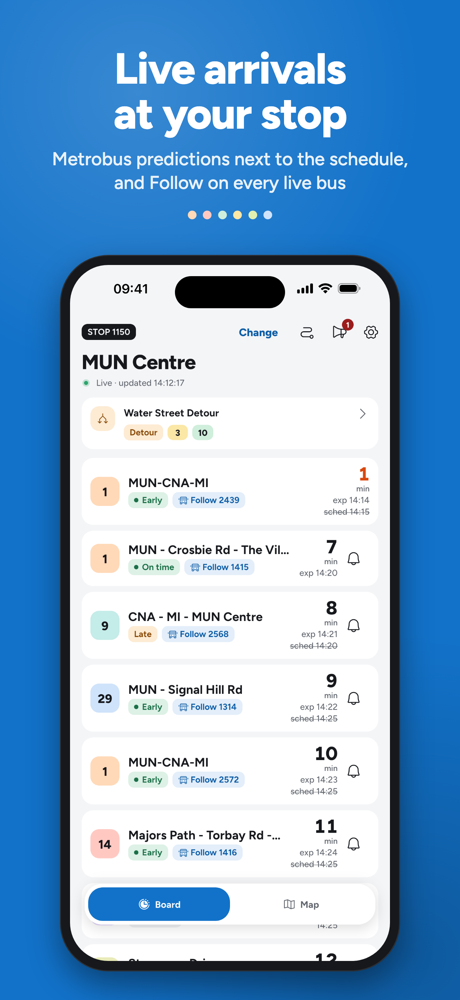
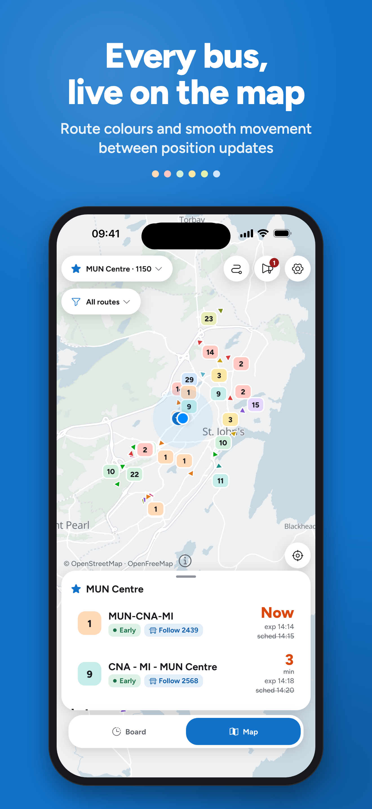
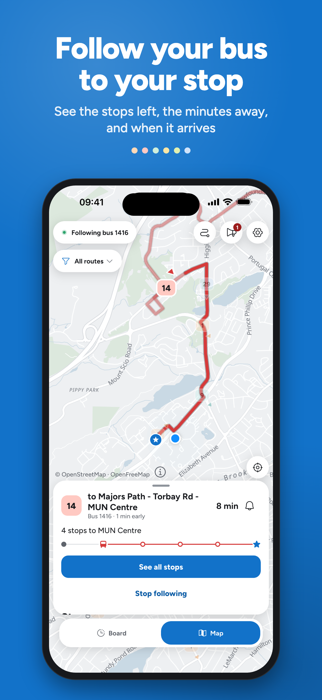
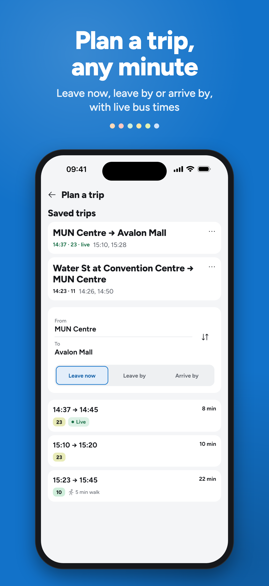

# BusBoard NL

Live arrivals and a live bus map for **Metrobus** riders in St. John's, Mount Pearl and Paradise, NL. Published on iOS and Android, used by 100+ riders a month.

[App Store](https://apps.apple.com/ca/app/busboard-nl/id6759234328) · [Google Play](https://play.google.com/store/apps/details?id=com.ahamsel.busboard_nl) · [Project page](https://ahamsel.com/busboard)

<!-- Demo video: drag BusBoardNL-1.5-tour.mp4 into this README in the GitHub web editor, it uploads and inserts a player link here -->

<table>
  <tr>
    <td></td>
    <td></td>
    <td></td>
    <td></td>
  </tr>
</table>

## Features

- **Arrival board** for any stop (4-digit ID or Near Me), with live AHEAD / BEHIND / ON TIME badges
- **Live map** of every bus, gliding along its route between GPS fixes instead of jumping
- **Follow a bus** to your stop, with a stop strip and ETAs for the rest of the trip
- **Trip planner**, **arrival alerts** and **service alerts**
- Light and dark map styles built on OpenFreeMap (no API key)

## Tech

Flutter / Dart, Riverpod, GoRouter, MapLibre, the GTFS static schedule plus Metrobus's public GTFS-Realtime feeds. Map motion logic is pure Dart in `lib/domain/map/` and is tested by replaying recorded live-feed captures (`test/fixtures/timetrack/`). About 100 test files.

## How it's built (Claude Code)

I build this app with Claude Code. Each feature starts as a written spec, then a step-by-step plan, then a build ledger, all kept in the repo:

- Specs: [`docs/superpowers/specs/`](docs/superpowers/specs/) (redesign, arrival alerts, trip planner)
- Plans: [`docs/superpowers/plans/`](docs/superpowers/plans/)
- Build notes: [`docs/superpowers/notes/`](docs/superpowers/notes/)

I review every diff and test on real devices before a store release.

---

## Data Sources

| Source | URL | Purpose |
|--------|-----|---------|
| GTFS Schedule ZIP | `metrobustransit.ca/google/google_transit.zip` | Static schedule (stops, routes, trips, stop times, shapes, calendars) |
| GTFS-Realtime Vehicle Positions | `mbusapi.ca/gtfsrt/vehiclepositions` | Live position, heading and trip of each bus |
| GTFS-Realtime Trip Updates | `mbusapi.ca/gtfsrt/tripupdates` | Predicted arrival times |
| GTFS-Realtime Service Alerts | `mbusapi.ca/gtfsrt/servicealerts` | Detours, delays and service changes |

All of these are public feeds Metrobus publishes for apps to use. If the GTFS-Realtime positions are unavailable, the app falls back to the older Metrobus TimeTrack JSON feed.

### Live data
Each vehicle reports its position, heading, physical vehicle ID and GTFS trip. GPS hardware on buses updates every ~15 seconds (variable per bus, 9–60s observed).

## Caching & Refresh Policy

- **GTFS ZIP**: Downloaded to app documents dir, cached for **7 days**. Manual re-download available in Settings.
- **Live data**: Polled every **5s** by default (configurable 5–60s). Applies to both the arrival board and map bus tracking.
- **Settings**: Persisted via SharedPreferences (selected stop, refresh interval, last GTFS update).

## Bus Motion

Buses on the map are drawn a little behind live and glide along their route between real GPS fixes (`lib/domain/map/`, pure Dart):

- **`BusTrackStore`** — one track per physical vehicle ID, built from each poll. Fixes are snapped to the GTFS route shape with a progress hint, so a bus on an out-and-back route stays on its own pass. Duplicate or out-of-order GPS timestamps are ignored; a bus with no new fix for 90 s is stale, and its track is dropped after 5 min.
- **`DelayedTrackRenderer`** — draws each bus at `now − D`, interpolated by distance along the shape between two real fixes. D is latency-aware (the largest recent feed lag plus 1 s, clamped to 8–40 s, typically about 40 s at rush hour) and eased in at 0.1 s per second.
- **Never backward** — a bus never moves backward along the same trip; when GPS runs backward it holds.
- **Edge cases** — geographic interpolation across a trip change, for off-route buses (over 150 m from the shape), for a bus driving its shape backward (a late trip switch), and for a step along the shape far longer than the map distance (a skipped loop or spur). Past the newest fix the bus dead-reckons, slowing, for at most 20 s and 55 m, then holds. Drawn motion is capped at 30 m/s, or 60 m/s along the route while catching up after a data gap of up to 3 min.
- **Replay fixtures** — `test/map/motion_replay_test.dart` replays recorded captures from `test/fixtures/timetrack/` through the pipeline (see the README there).

## Architecture

```
lib/
  main.dart / app.dart              → Entry point & Material theme
  routing/router.dart               → GoRouter (bottom nav: Board, Map, Settings)
  data/
    gtfs/                           → GTFS download, parse, models, time utils
    realtime/                       → GTFS-Realtime client (TimeTrack fallback) & models
  domain/
    arrival/                        → Arrival computation & live merging
    location/                       → Nearest stop (haversine)
    map/
      route_geometry.dart           → Snap to shapes, poses along them, stop/timetable hints
      bus_track.dart                → GPS fixes and tracks per vehicle
      bus_track_store.dart          → Ingests each poll into per-vehicle tracks
      delayed_track_renderer.dart   → Where to draw each bus now (about 40 s behind, gliding)
      bus_tracking_state.dart       → Per-bus snapshot for the map and sheet
      heading_smoother.dart         → Eases bus heading changes so notches don't flick
      shape_matcher.dart            → Snap GPS to route geometry
  ui/
    stop_picker/                    → Stop ID entry + Near Me list
    board/                          → Arrival board + row tiles
    map/
      map_screen.dart               → The Map tab: chips, my-location, credit link, one floating sheet
      map_view.dart                 → MapLibre widget behind an injectable builder (tests stub it)
      map_surface.dart              → The slice of MapLibre the screen uses (camera, sources, layers), faked in tests
      map_layers.dart               → Stop, your-stop and bus layers; bus markers for each frame
      marker_images.dart            → Draws the badge, notch and star marker images
      map_style.dart                → Picks the light or dark Harbour style asset
      map_hit_test.dart             → Tap to nearest bus or stop
      stop_card.dart                → Stop card and arrivals list
      bus_card.dart                 → Bus card and technical details
      my_stop_card.dart             → Your-stop card (the sheet's default)
      route_filter_card.dart        → Floating route filter
    settings/                       → Refresh interval & GTFS management
  state/providers.dart              → Riverpod providers (polling stream, track store, renderer, settings)
  state/map_providers.dart          → Map selection, route filter, per-stop arrivals, app foreground state
```

## Building

- Android builds need JDK 21 (maplibre_gl 0.27 targets Java 21). Point Gradle at it, for example with `JAVA_HOME` and `GRADLE_OPTS=-Dorg.gradle.java.home=<jdk21>`.
- The iOS deployment target is 15.0 (the minimum Flutter 3.47 supports).
- Release builds are signed from `android/key.properties`, which is not checked in.

## How to Run

```bash
# Install dependencies
flutter pub get

# Run on connected device / emulator
flutter run

# Run tests
flutter test

# Replay recorded captures through the motion pipeline
flutter test test/map/motion_replay_test.dart

# Measure the motion on a full local capture (skipped without these files)
PROBE_CAPTURE=test/fixtures/timetrack/capture_2026-10-05.json PROBE_GTFS=build/gtfs_2026-09-01 \
  flutter test test/map/probe_rush_hour_test.dart

# Regenerate the two map styles from OpenFreeMap Positron
dart run tool/build_map_styles.dart

# Capture the app's real production live-data chain (example: 15 minutes)
dart run tool/capture_timetrack_snapshots.dart \
  --interval 5 \
  --duration 900 \
  --out /tmp/capture.json

# Inspect raw physical IDs, duplicate assignments, teleports, and A→B→A
# ping-pongs before replaying what the app renders.
dart run tool/analyze_live_vehicle_trace.dart \
  /tmp/capture.json
```

## Key Technical Notes

- **GTFS times >24:00:00** are handled correctly (e.g., `25:10:00` = 1:10 AM next day)
- **Live ETA**: `predicted = scheduled − sched_difference_mins` (positive diff = bus ahead = arrives earlier)
- **Timezone**: App uses device local time; designed for America/St_Johns
- **No database**: All GTFS data is held in-memory via indexed maps for fast lookup
- **GPS update cadence**: Bus GPS hardware reports periodically; the app polls every 5s to catch new observations promptly.
